# Smart Crop Advisor (PAI101)

An AI advisor for a farmer. It reads seven field readings (soil nitrogen **N**, phosphorus **P**, potassium **K**, soil **pH**, **temperature**, **humidity**, **rainfall**) and then:

1. recommends the best crop and gives a **0–100% suitability score for every crop**,
2. says when a crop is a **poor or unsuitable fit** (score under 30%) and what is holding the score back,
3. estimates **yield**,
4. places the farm in a **climate zone** (clustering),
5. applies **expert rules** (forward and backward chaining) for irrigation, fertiliser and soil advice,
6. **explains** every result, and runs **entirely in the browser** (no server, no data leaves the device).

Models are trained in Python and exported to JSON; a static website runs them with plain JavaScript. A parity test proves the JavaScript gives the same answers as Python.

> **Read this first (honesty note).** The public crop dataset contains only *good* fields for each crop, so on its own it cannot teach "this field is bad for rice". No public dataset with weak fields was found, so we **generated one ourselves**: `data/processed/synthetic_crop_dataset.csv`. Its suitability labels follow a stated formula (explained below), so they are *synthetic, not measured on real farms*. Everything that depends on it is labelled as such.

---

## Contents

1. [Headline results](#1-headline-results)
2. [Tech stack](#2-tech-stack)
3. [Project structure](#3-project-structure)
4. [How to run](#4-how-to-run)
5. [Data](#5-data) – raw datasets, cleaning, and the synthetic dataset
6. [Code walkthrough, section by section](#6-code-walkthrough-section-by-section)
   - [01_prepare.py – data preparation and analysis](#61-01_preparepy--data-preparation-and-analysis)
   - [01b_synthetic.py – the synthetic dataset](#62-01b_syntheticpy--the-synthetic-crop-dataset)
   - [02_train.py – models, explainability, export](#63-02_trainpy--models-explainability-export)
   - [03_analysis.py – statistics, ablation, cross-dataset validation](#64-03_analysispy--statistical-analysis-ablation-study-cross-dataset-validation)
   - [engine.py – the rule-based expert system](#65-sourcerulesenginepy--the-rule-based-expert-system)
   - [The website (`frontend/`)](#66-the-website-frontend)
   - [Tests](#67-tests)
7. [Part 03 in detail](#7-part-03-in-detail) – **Statistical analysis**, **Ablation study**, **Cross-dataset validation**
8. [Mapping to the PAI101 syllabus](#8-mapping-to-the-pai101-syllabus)
9. [Limitations, ethics, security](#9-limitations-ethics-security)
10. [Deployment](#10-deployment)

---

## 1. Headline results

| Task | Method | Result (held-out data) |
|---|---|---|
| Crop recommendation (22 crops) | Decision tree (depth 11 by CV) | **97.7%** accuracy |
| | Random forest (30 trees) | **99.1%** accuracy |
| | Neural network (64-32, ReLU) | **99.1%** accuracy |
| Yield prediction | Linear regression (Ridge identical) | R² **0.638**, MAE 32,040 hg/ha (= 3.2 t/ha), RMSE 51,004 |
| Climate zones | K-means, k = 10 | silhouette 0.349, homogeneity vs real crops 0.64 |
| Suitability score | Monotone gradient boosting on the synthetic dataset | R² **0.949**, MAE 0.046; **91.9%** of unsuitable rows score < 30%; top-scoring crop = true crop on real fields **97.3%** |
| Edge AI | everything in the browser | model JSON **182 KB**; tree 15.7 KB / 0.07 ms, forest 773 KB / 1.2 ms, network 121 KB / 0.16 ms per prediction |
| AI security demo | label poisoning of the tree | accuracy 97.7% → 95.5% → 92.5% → 81.1% with 0 / 5 / 10 / 20% wrong labels |
| Cross-dataset | train on ours, test on 22,800 wider-spread rows | tree 71.6%, forest 84.1%, network 88.5%, suitability 91.4% |

All numbers come from `source/models/metrics.json` and `source/models/analysis.json`, written by the scripts.

---

## 2. Tech stack

| Layer | Tools | Used for |
|---|---|---|
| Language | Python 3.10, JavaScript (ES modules) | training / website |
| Data | pandas 2.3, NumPy 2.2 | loading, cleaning, arrays |
| Statistics | SciPy 1.15 | t-test, ANOVA, McNemar (binomial test), Wilcoxon, KS test |
| Machine learning | scikit-learn 1.7 | decision tree, random forest, MLP, K-means, PCA, linear/Ridge regression, histogram gradient boosting, cross-validation |
| Explainability | SHAP 0.49, feature importance, `plot_tree` | Module 6 |
| Graphs | matplotlib 3.10, seaborn 0.13 | all figures |
| Notebook | nbformat, nbclient, ipykernel | `build_nb.py` assembles and runs the notebook |
| Expert system | plain Python and plain JavaScript (dictionaries and loops) | forward / backward chaining |
| Website | HTML, CSS, vanilla JS, **Three.js** (3D hero), **GSAP + ScrollTrigger + SplitText**, **Lenis** (smooth scroll), Geist fonts (self-hosted) | UI and animation |
| Hosting | Vercel (static), GitHub | deployment |
| Testing | Node.js (`parity.mjs`), Python `assert` self-checks | JS-vs-Python parity, monotonicity, rule engine |

Dependencies are pinned in [`requirements.txt`](requirements.txt). The website needs **no build step and no npm packages** (libraries are vendored in `frontend/vendor/`).

---

## 3. Project structure

```
data/
  raw/            crop_recommendation.csv (2,200 rows), yield_df.csv (28,242 rows)        <- public datasets
  processed/      crop_clean.csv, yield_clean.csv                                          <- cleaned
                  synthetic_crop_dataset.csv   <- GENERATED BY US (weak / poor fields)
                  crop_profile.json            <- per-crop median and spread used by the suitability score
  external/       (created on demand, not in git) cross-dataset file downloaded by 03_analysis.py
source/
  notebooks/      01_prepare.py, 01b_synthetic.py, 02_train.py, 03_analysis.py  ("# %%" cells)
                  build_nb.py                  <- joins them into smart_crop_advisor.ipynb and runs it
                  smart_crop_advisor.ipynb     <- the notebook with all outputs and graphs
  models/         metrics.json, analysis.json, eda.json, *.joblib, figures/*.png
  rules/          engine.py                    <- expert system (Python)
  tests/          parity.mjs, parity_cases.json
frontend/         the website (deploy this folder)
  index.html, css/style.css
  js/             app.js, model.js, rules.js, motion.js, hero3d.js
  data/           model.json (all models), rules.json (expert rules)
  vendor/         three.js, gsap, lenis, fonts
  vercel.json
```

---

## 4. How to run

```bash
pip install -r requirements.txt

# rebuild everything (about 2 minutes). Order matters.
python source/notebooks/01_prepare.py      # clean data + EDA
python source/notebooks/01b_synthetic.py   # generate the synthetic dataset
python source/notebooks/02_train.py        # train, evaluate, export frontend/data/model.json
python source/notebooks/03_analysis.py     # statistics, ablation, cross-dataset (downloads one CSV; skipped offline)

# or run everything as one notebook with inline graphs
python source/notebooks/build_nb.py        # writes source/notebooks/smart_crop_advisor.ipynb

# checks
python source/rules/engine.py              # rule engine self-test
node source/tests/parity.mjs               # JS models == Python models, suitability monotone

# run the website locally
cd frontend && python -m http.server 8000  # then open http://localhost:8000
```

Every script is seeded (`SEED = 42`), so results are repeatable.

---

## 5. Data

### 5.1 Raw datasets (public)

| File | Rows | What it holds | Used for |
|---|---|---|---|
| `crop_recommendation.csv` ("Crop Recommendation Dataset", Kaggle) | 2,200 | N, P, K, temperature, humidity, pH, rainfall + crop label; 22 crops × 100 rows | classification, clustering, rules, suitability profiles |
| `yield_df.csv` (FAO-derived crop yield, Kaggle) | 28,242 | country, crop, year, yield (hg/ha), rainfall, pesticides, temperature | yield regression |

Both are described in the project brief (`Smart Crop Advisor.pdf`). The crop data is **not raw field measurement**: it is a widely used teaching dataset that was assembled for India and is partly augmented, so accuracy on it is high by construction.

### 5.2 Cleaning (done in `01_prepare.py`)

Crop data: 0 missing, 0 duplicates, 0 impossible values (pH outside 0–14, humidity outside 0–100, negatives), so all 2,200 rows are kept. Yield data: 2,310 duplicates and rows with non-positive yield or negative inputs removed, leaving **25,932** rows.

### 5.3 The synthetic crop dataset (generated by us)

**Problem.** Each crop in the real data appears only under good conditions. A model trained on it answers "which crop's ideal profile do these readings resemble?", so *any* field that resembles some crop scores 90%+ for it, even a weak one. It never sees a field that is bad for a crop.

**Solution.** `01b_synthetic.py` builds `synthetic_crop_dataset.csv`: **2,200 rows (same size as the real data), 100 per crop**:

| Rows per crop | `how_generated` | How it is made | Meaning |
|---|---|---|---|
| 40 | `real_good` | real rows of that crop | strong conditions |
| 21 | `other_crop` | one real row from **each of the 21 other crops** | the crop placed in another crop's conditions (e.g. rice in chickpea weather); covers **all 462 crop × crop pairs** |
| 20 | `blend` | own row mixed 20–70% with another crop's row | marginal fields |
| 10 | `single_extreme` | own row with **one** reading pushed to the dataset min or max | drought, frost, acid soil, etc. |
| 9 | `one_reading_off` | own row with 1–2 readings replaced by another crop's values | one thing wrong |

Columns: `crop, N, P, K, temperature, humidity, ph, rainfall, suitability, tier, how_generated, borrowed_from`.

**The suitability label is a formula, not random.** For crop *c* and readings *x*:

```
z_f   = (x_f − median_c,f) / scale_c,f           median and scale from the real rows of crop c
        scale = max(std, 8% of the dataset range)   (stops very tight crops being hypersensitive)
d²    = 0.5 · mean(z²)  +  0.5 · max(z²) / 3.5     average deviation plus the worst single reading
score = exp(−d² / 2.6)                              1 = typical field for c, → 0 as readings move away
tier  = suitable if ≥ 0.70, marginal if 0.30–0.70, unsuitable if < 0.30
```

**Worked example** (rice, readings N 60, P 58, K 60, T 21.5, H 49.5, pH 6.8, rain 157): rice's medians are 80, 47, 40, 23.73, 82.19, 6.36, 233.12 and scales 11.92, 11.2, 16.0, 2.79, 6.86, 0.77, 34.29. So z = [−1.68, 0.98, 1.25, −0.80, **−4.77**, 0.57, −2.22], mean z² = 4.85, max z² = 22.72, d² = 0.5·4.85 + 0.5·22.72/3.5 = 5.67, score = exp(−5.67/2.6) = **0.113** (11%, unsuitable). Humidity is the culprit. The trained model returns 16.6% for the same row.

**Sanity checks printed by the script** (and shown in the notebook):

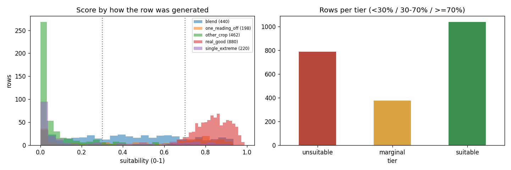

- 2,200 rows, 22 crops, 100 each; all 462 crop × other-crop pairs present.
- 91% of "other crop's conditions" rows score under 30% (the other 9% are genuinely similar crops, e.g. lentil vs mungbean, so a high score is correct).
- 95% of real good fields score ≥ 70%.
- Tier counts: 787 unsuitable, 376 marginal, 1,037 suitable.

---

## 6. Code walkthrough, section by section

### 6.1 `01_prepare.py` – data preparation and analysis

| Section | What it does | Why | Output |
|---|---|---|---|
| Crop data checks | counts missing, duplicates, impossible values; drops bad rows; saves `crop_clean.csv` | bad rows corrupt every later step; the same range rules protect the web app (AI security) | `eda.json → crop_raw` |
| Descriptive + exploratory | mean, std, quartiles per reading; samples per crop; mean per crop; correlation heatmap; histograms; rainfall box plot | learn ranges and spot outliers | 3 graphs below |
| Inferential | Welch t-test rice vs chickpea rainfall with 95% CI; one-way ANOVA across 22 crops | brief requires inferential analysis | see numbers below |
| Yield data | drops index column, duplicates, non-positive yield; saves `yield_clean.csv`; correlation heatmap | regression needs clean rows | `yield_correlation.png` |

**Results.** Rice rainfall averages 236 mm vs chickpea 80 mm: Welch **t = 44.35, p = 7.6 × 10⁻⁷²**, 95% CI of the difference **[149.15, 163.10] mm**. ANOVA across all crops: **F = 605.5, p ≈ 0**. Crops genuinely differ in rainfall. In the yield data the correlations of yield with rainfall (−0.00), pesticides (0.07) and temperature (−0.11) are near zero, so **crop type, not weather, explains most yield variance**.

| Correlation of readings (Pearson r) | Histograms | Rainfall by crop |
|---|---|---|
| 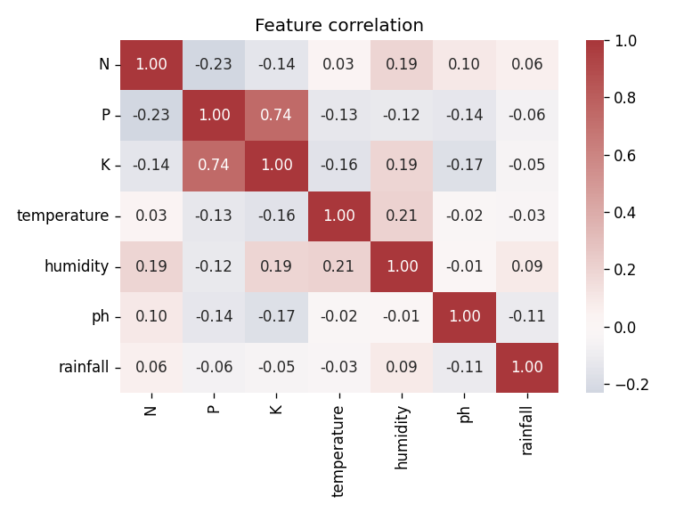 | 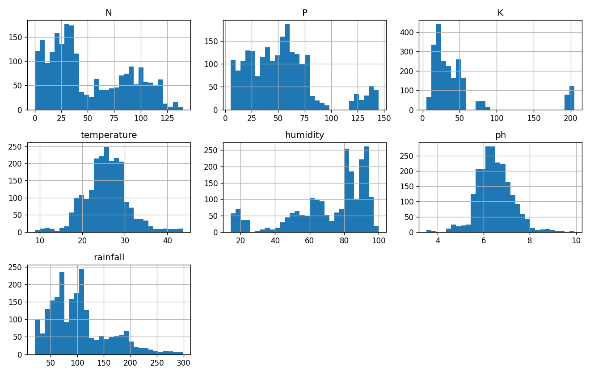 | 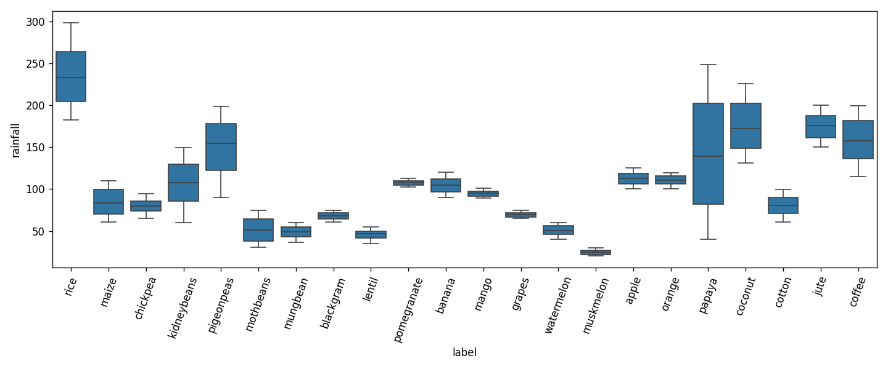 |

*Reading the graphs:* P and K correlate at r = 0.74 (apple and grapes need both). In the box plot rice (mean 236 mm), jute (175) and coconut (176) are wet crops, while muskmelon (25), lentil (46), mungbean (48) and mothbeans (51) are dry.

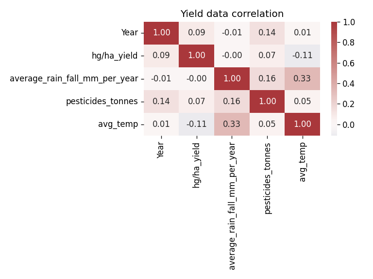

### 6.2 `01b_synthetic.py` – the synthetic crop dataset

| Section | What it does |
|---|---|
| Header (markdown) | states clearly that the data is generated, lists the five row types |
| Profile + formula | computes each crop's median and scale from the real data; defines `suitability(crop, x)` and `tier(score)` (formula in §5.3) |
| Row generation | for each crop: 40 real rows, 21 other-crop rows (all pairs), 20 blends, 10 single-extreme rows, 9 one-reading-off rows; clips values to the real dataset range; scores each row with the formula |
| Sanity checks | asserts all 462 pairs are present; prints score statistics per row type; checks real fields score high and other crops score low |
| Graph | histogram of scores per row type and tier counts (graph in §5.3) |
| Profile export | writes `crop_profile.json` (median + scale per crop) so training and the browser use the identical formula inputs |

### 6.3 `02_train.py` – models, explainability, export

Every model uses the **same stratified 80/20 split** (440 test fields, every crop in both sets, seed 42).

**Module 1 – decision tree vs random forest.** Tree depth 3–12 is compared by 5-fold CV on the training set; accuracy rises from 22.7% (depth 3) to **98.4% at depth 11–12** and depth **11** is kept (control of overfitting). A 30-tree forest (max depth 10) is the comparison. Results: tree **97.73%** (train 98.98%), forest **99.09%** (train 99.66%).

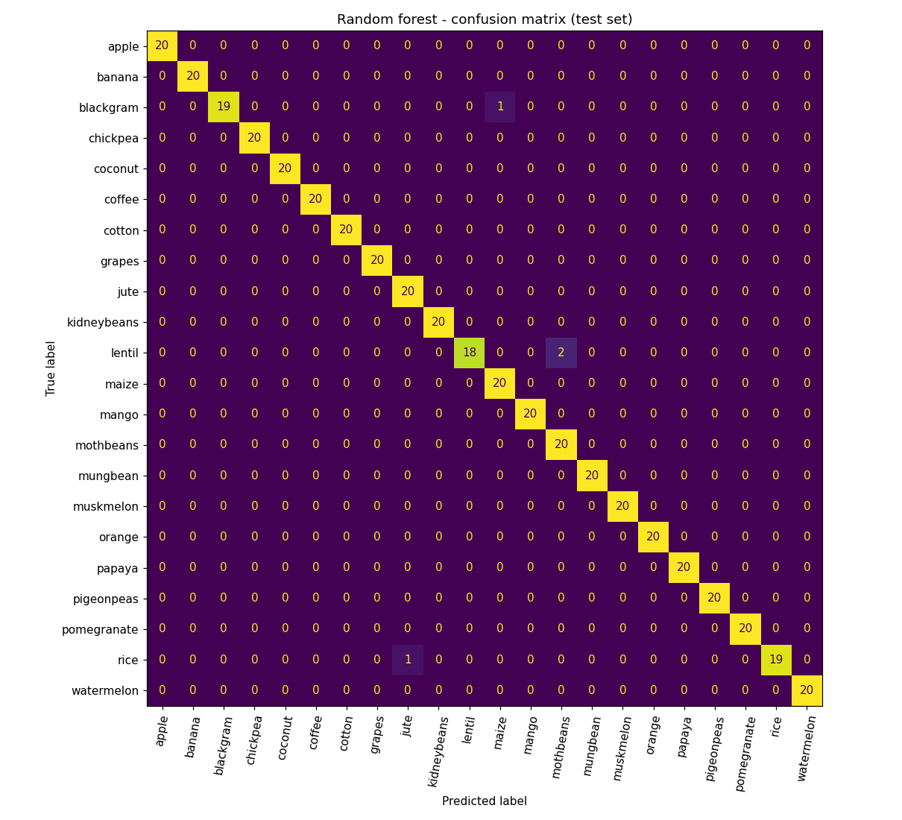

*Confusion matrix of the forest:* rows are the true crop, columns the prediction; the bright diagonal is correct answers. Per-crop precision and recall are in `metrics.json → rf_per_crop`. Almost every crop is 1.00; the few errors are between similar crops (e.g. blackgram recall 0.95).

| Tree, first 3 levels (readable rules) | Forest feature importance |
|---|---|
| 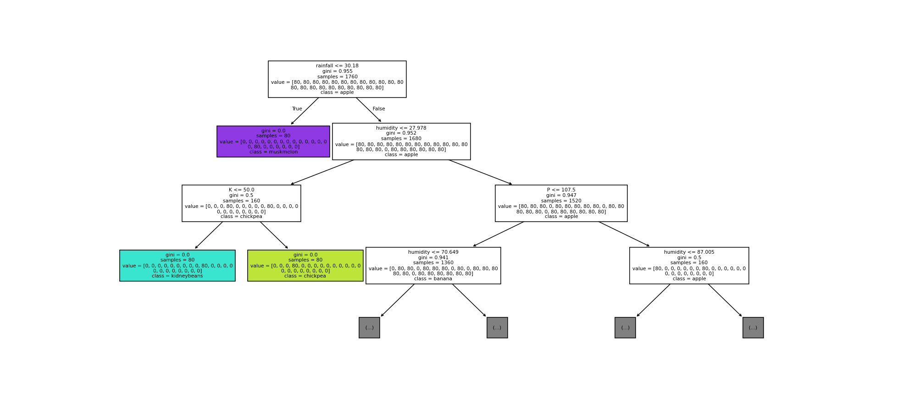 | 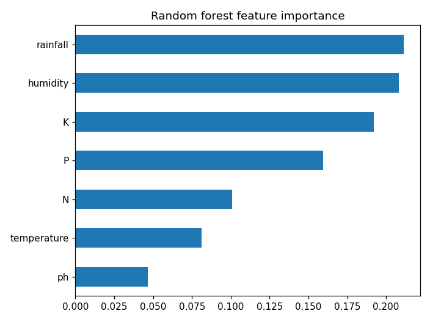 |

Importance (share of impurity reduction): rainfall 0.211, humidity 0.208, K 0.192, P 0.159, N 0.101, temperature 0.081, pH 0.047.

**Module 3 – neural network.** Input standardised with a scaler **fitted on the training set only** (fitting on all data would leak test information); layers 7 → 64 → 32 → 22 (ReLU, softmax). **99.09%** test accuracy, 408 epochs, about 2 s. The loss curve falls smoothly to near zero (converged):

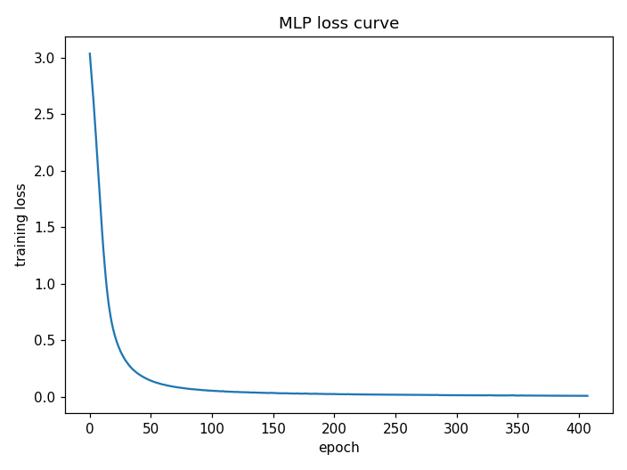

| | Accuracy | Train time | Explainable? |
|---|---|---|---|
| Decision tree | 97.7% | 0.009 s | yes, readable rules |
| Random forest | 99.1% | 0.06 s | partly (importances, SHAP) |
| Neural network | 99.1% | 2.0 s | no, black box |

**Module 6 – SHAP.** Shapley values give each reading a share of credit per prediction; the mean absolute value over 200 test fields ranks the readings: humidity 0.032, K 0.030, P 0.027, rainfall 0.024, N 0.022, temperature 0.011, pH 0.004. (Different explainers weigh correlated readings differently: the forest's own importance ranks rainfall first.)

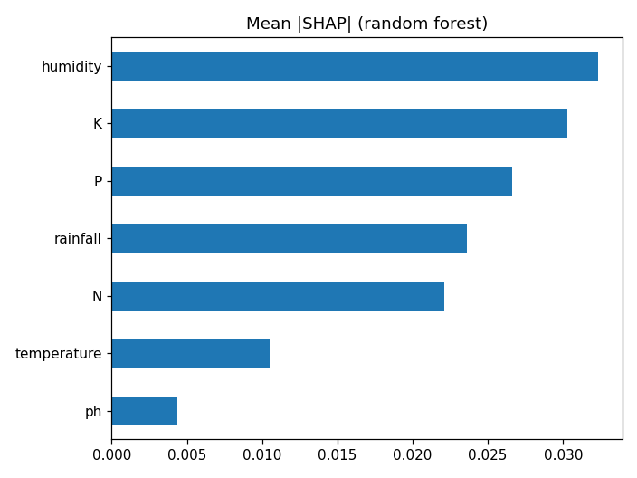

**Module 4 – K-means zones (labels not used).** Readings are standardised; k = 2…10 is compared by silhouette score, restricted to k ≥ 4 because 2–3 zones are too coarse to describe in words. Chosen **k = 10** (silhouette 0.349; homogeneity against the real crops 0.64). Each zone is described in words from its centre (readings further than 0.5 standard deviations from average), e.g. zone 1 "high nitrogen" (335 farms), zone 4 "low nitrogen, low potassium, alkaline soil, low rainfall" (390 farms).

| Elbow and silhouette | Zones drawn in 2-D (PCA) |
|---|---|
| 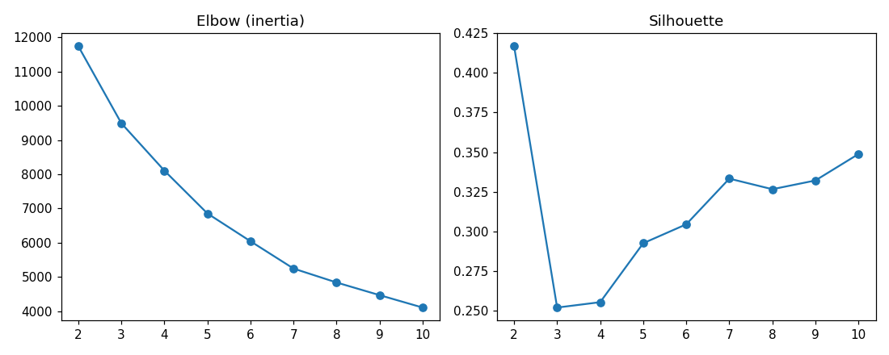 | 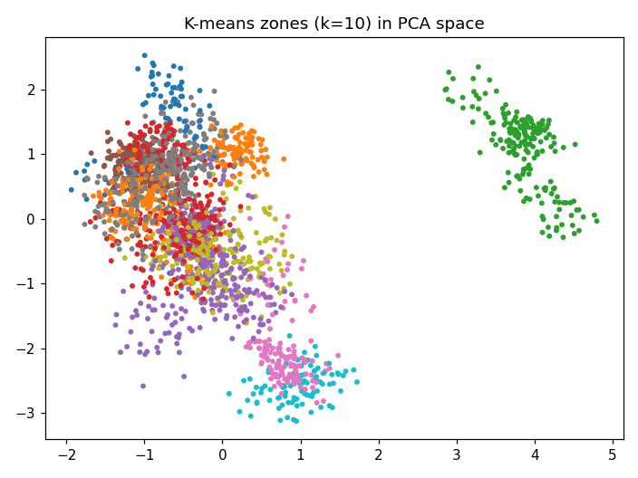 |

**Module 2 – yield regression.** Crop type (one-hot) + annual rainfall + pesticides + temperature → yield (hg/ha). MAE 32,040 hg/ha (3.2 t/ha), RMSE 51,004, **R² 0.638** for linear; Ridge is identical; a random forest (reference only) reaches R² 0.967 but is too big for the browser and shows the true relation is non-linear. The website therefore says "rough idea only" and covers only the crops the yield data contains.

**Module 7 – Edge AI.** Measured size and speed: tree **15.7 KB / 0.07 ms**, forest 773 KB / 1.2 ms, network 121 KB / 0.16 ms. The whole browser model is **182 KB**, so it runs offline on a phone. (ONNX or TensorFlow Lite would be the next step for a microcontroller.)

**Module 8 – label poisoning.** Random wrong labels are injected into the training set and the tree is retrained:

| Poisoned labels | 0% | 5% | 10% | 20% | 30% |
|---|---|---|---|---|---|
| Tree accuracy | 97.7% | 95.5% | 92.5% | 81.1% | 82.5% |

(30% is a noisy tail; the trend is clear.) Defences used: range validation of inputs, trusted data sources, human in the loop.

**Suitability model.** Input = **absolute distance from the crop's typical value** per reading, `|z|` clipped at 6; output = suitability 0–1. Model = histogram gradient boosting (300 trees) with a **monotonic constraint**: a reading moving further from typical can never raise the score, so improving a reading never lowers it. Held-out results: R² 0.949, MAE 0.046, tier accuracy 91.8%, 91.9% of truly-unsuitable rows predicted under 30%. **Independent check:** on the *real* held-out fields (not generated), the crop with the highest suitability is the true crop **97.3%** of the time. The R² only shows the model reproduces our formula; this last number is the one that does not depend on it.

**Export.** Everything is written to `frontend/data/model.json`: tree, forest (sparse leaf probabilities), MLP weights, K-means zones, yield coefficients, per-crop percentile bands `[p10, median, p90]` (the rule engine's thresholds), and the suitability trees. `parity_cases.json` stores Python predictions for the JavaScript to reproduce.

### 6.4 `03_analysis.py` – statistical analysis, ablation study, cross-dataset validation

Explained in detail with all results in [section 7](#7-part-03-in-detail).

### 6.5 `source/rules/engine.py` – the rule-based expert system

A **propositional-logic knowledge base** in `frontend/data/rules.json`: 16 IF-THEN rules, shared by Python and JavaScript.

- **Facts** are made from the readings: for the recommended crop, a reading below its 10th percentile gives `LowX`, above the 90th gives `HighX` (thresholds come from the data, not invented).
- **Forward chaining** (`forward_chain`): start from the facts, fire every rule whose conditions all hold, add its conclusion, repeat until nothing new appears. Example: `LowRainfall ∧ LowHumidity → DrySpell` (R1), then `DrySpell → Irrigate` (R2): a two-level chain.
- **Backward chaining** (`backward_chain`): start from a goal such as "Irrigate" and work back to the facts it needs, returning the proof lines. It guards against cyclic rules.
- `advise()` maps the final facts to farmer-friendly sentences. The self-test (`python source/rules/engine.py`) asserts the chain, the proof, an unprovable goal and "typical farm → no advice".

### 6.6 The website (`frontend/`)

| File | Role |
|---|---|
| `index.html` | page structure: hero, advisor (form + result cards), "How it works", agent design (PEAS), responsible-use cards, footer |
| `css/style.css` | dark-green theme, layout, responsive rules |
| `js/app.js` | the app: builds the form, validates, calls the models, renders results |
| `js/model.js` | **inference** in JavaScript: `forestProba`, `treePredict`, `mlpProba`, `zone`, `predictYield`, `validate`, `suitability` |
| `js/rules.js` | expert system in JavaScript (`deriveFacts`, `forwardChain`, `backwardChain`) |
| `js/motion.js`, `js/hero3d.js` | GSAP/Lenis animations and the Three.js crop-field hero |
| `data/model.json`, `data/rules.json` | exported models and rules |
| `vercel.json` | `cleanUrls` for static hosting |

**What happens when you press "Advise me"** (`app.js`):

1. `validate` rejects impossible values (pH outside 0–14, negative N, humidity > 100 …) and warns when a value is outside the training range (a defence against faulty or spoofed sensors).
2. `suitability(crop, x)` is computed for **all 22 crops**; the highest is the recommendation, the next three are "Other options".
3. **Field fit:** how many of the 7 readings lie inside the crop's usual 10th–90th percentile band. Score < 30% → "No crop fits well … very low chance"; 30–70% → "marginal fit".
4. **Why this score?** For each reading, the score is recomputed with that reading set to the crop's typical value; the rise is shown as a bar ("+13%"). Because the model is monotone this is never negative. The biggest bars are the readings holding the score back; "fine" means no cost.
5. **Can I grow a specific crop here?** Pick any crop to see its score and verdict (best match / good fit / marginal / unsuitable with "very low chance of growing here").
6. The **radar chart** plots your readings against the crop's usual band; the **rule engine** adds advice and shows the forward/backward-chaining proof; the **classifier table** cross-checks the tree, forest and network and says if they disagree with the suitability pick; the **yield box** uses the separate regression model.

### 6.7 Tests

| Test | What it proves |
|---|---|
| `node source/tests/parity.mjs` | JS tree, forest, network and zone match Python on 150 test fields (100% each); JS suitability matches Python (max difference ≤ 0.002, from rounding the stored inputs); **400 random "make one reading worse" checks never raise the score** |
| `python source/rules/engine.py` | chain depth, proof, unprovable goal, no-advice case |
| Notebook run | `build_nb.py` executes all 61 cells with zero errors |

---

## 7. Part 03 in detail

`03_analysis.py` answers three questions that a single accuracy number cannot: *which parts matter* (ablation), *are differences real* (statistics), *does it generalise* (cross-dataset). It is in the notebook (Part 3) and writes `source/models/analysis.json`.

### 7.1 Statistical analysis

**A1. Bootstrap 95% confidence intervals.** The test set has only 440 fields, so 99.1% is an estimate. The 440 predictions are resampled with replacement 2,000 times; the 2.5th and 97.5th percentiles give the interval.

| Model | Test accuracy | 95% CI |
|---|---|---|
| Decision tree | 97.7% | [96.1%, 99.1%] |
| Random forest | 99.1% | [98.2%, 99.8%] |
| Neural network | 99.1% | [98.2%, 99.8%] |

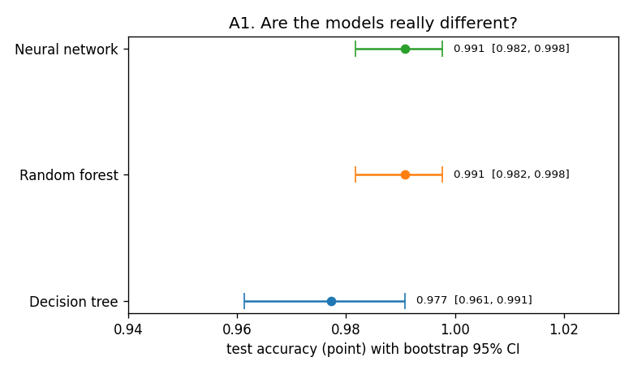

*Reading it:* the forest and network intervals overlap completely (no evidence either is better on this split); the tree's interval is lower but overlaps theirs, so on 440 fields alone the gap is only borderline (McNemar below: significant against the forest, not against the network).

**A2. McNemar's exact test** (do two models make different mistakes on the same fields?): count fields where only model 1 is right (b) and only model 2 is right (c); an exact binomial test of b vs b + c gives p.

| Pair | only 1st right | only 2nd right | p | Significant (5%) |
|---|---|---|---|---|
| Tree vs forest | 0 | 6 | 0.031 | **yes** |
| Tree vs network | 3 | 9 | 0.146 | no |
| Forest vs network | 3 | 3 | 1.000 | no |

**A3. Repeated 5-fold CV (3 repeats = 15 splits) + paired tests.**

| Model | CV accuracy (mean ± sd) |
|---|---|
| Decision tree | 98.65% ± 0.47 |
| Random forest | 99.47% ± 0.31 |
| Neural network | 98.61% ± 0.41 |

Paired t-test / Wilcoxon: forest > tree (difference 0.82 points, p = 2.8 × 10⁻⁵ / 0.0014); forest > network (0.86 points, p = 7 × 10⁻⁶ / 0.0006); tree vs network no difference (p = 0.71 / 0.53). *Caveat:* CV folds share training data, so these p-values are optimistic. **Conclusion:** the random forest is genuinely the best of the three; the neural network ties it on the single split but is worse in cross-validation.

**A4. Effect size (ANOVA η²).** η² = variance between crops / total variance, per reading (0 = crop says nothing, 1 = crop determines it). A p-value cannot say *how much*; η² can.

| K | humidity | P | N | rainfall | temperature | pH |
|---|---|---|---|---|---|---|
| 0.996 | 0.968 | 0.948 | 0.896 | 0.854 | 0.496 | 0.368 |

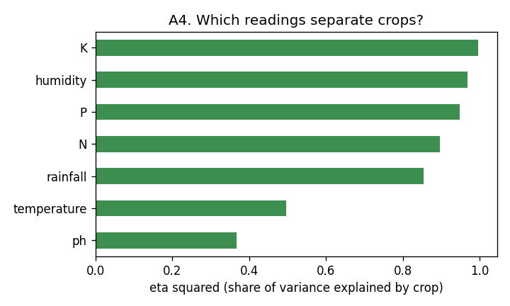

K, humidity and P separate the crops best; temperature and pH least. This agrees with SHAP in §6.3.

### 7.2 Ablation study

An ablation removes one component and measures the damage. Components that cost nothing to remove are candidates to delete; components whose removal hurts are justified.

**B1. Leave-one-feature-out** (random forest, 5-fold CV accuracy; full model 99.50%):

| Removed | Accuracy | Change |
|---|---|---|
| N | 99.41% | −0.09 |
| temperature | 99.36% | −0.14 |
| pH | 99.23% | −0.27 |
| P | 98.91% | −0.59 |
| K | 98.86% | −0.64 |
| humidity | 98.18% | −1.32 |
| rainfall | 96.64% | −2.86 |
| N, P, K together (soil nutrients) | 96.05% | −3.45 |
| temperature + humidity + rainfall (climate) | **80.23%** | **−19.27** |

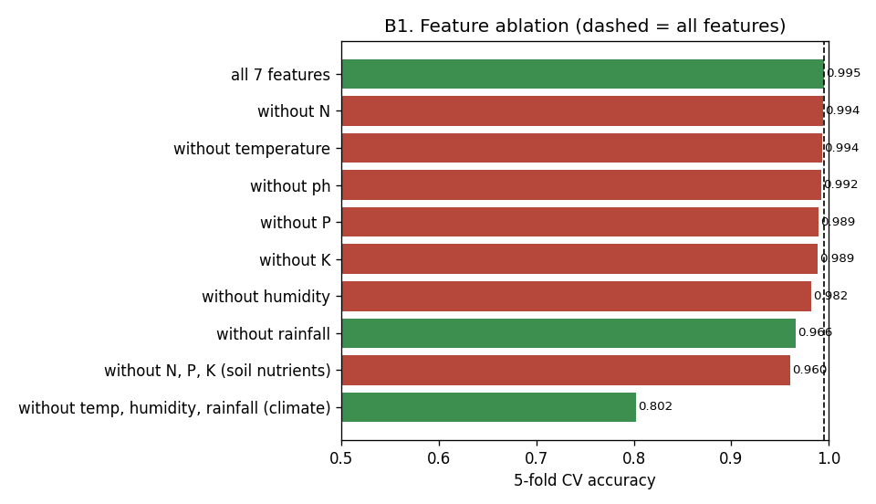

*Findings:* no single reading is critical, because readings are redundant (dropping any one costs ≤ 2.9 points), but **climate readings as a group are essential** (−19 points). Rainfall is the most valuable single sensor; N, temperature and pH are the cheapest to drop, which matters for a low-cost device.

**B2. Forest size (Edge AI trade-off).**

| Trees | 1 | 3 | 5 | 10 | **30** | 100 |
|---|---|---|---|---|---|---|
| Test accuracy | 95.0% | 98.6% | 98.4% | 98.6% | **99.1%** | 99.6% |
| Total nodes (size) | 111 | 317 | 551 | 1,076 | **3,220** | 11,720 |

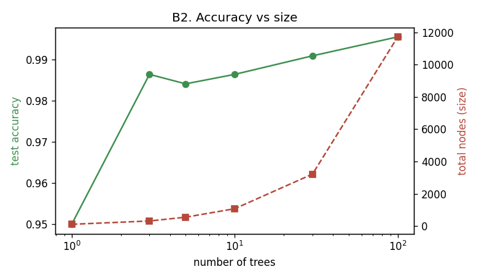

30 trees is a compromise: 100 trees add 0.5 points for 3.6× the size.

**B3. Suitability model ablation** (same held-out synthetic rows; "violations" = share of cases where making one reading 1.5× further from typical wrongly *raises* the score):

| Variant | R² vs label | MAE | Monotone violations | Top crop = true crop (real fields) |
|---|---|---|---|---|
| **Full model** (monotone, all row types) | 0.949 | 0.046 | **0.0%** | 97.3% |
| No monotone constraint | 0.992 | 0.020 | **15.7%** | 97.7% |
| Only good + other-crop rows (no marginal examples) | 0.745 | 0.098 | 0.0% | 96.8% |
| Classifier only (forest probability as the score) | 0.532 | 0.170 | 0.5% | **99.1%** |

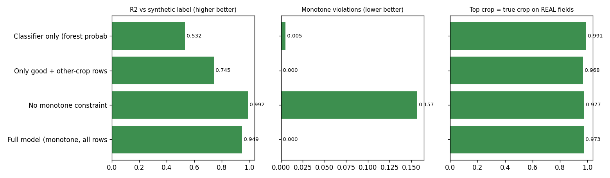

*Findings.* (1) The **monotone constraint costs fit** (R² 0.992 → 0.949) but removes 15.7% nonsensical cases, which is the property a farmer relies on ("improve a reading and the score goes up"). (2) **Marginal training rows matter**: without blends, single-extreme and one-reading-off rows, R² falls to 0.745. (3) A **classifier alone cannot give a field score** (R² 0.532): its probability jumps because forests are piecewise-constant and have never seen bad fields. (4) *Honest trade-off:* as a pure crop *picker* on real fields the forest is slightly better (99.1% vs 97.3%); the suitability score adds the absolute "how good is this field" meaning the forest lacks. The website shows the classifier cross-check next to the suitability pick for this reason.

Rice suitability as rainfall is swept 20 → 300 mm (other readings typical):

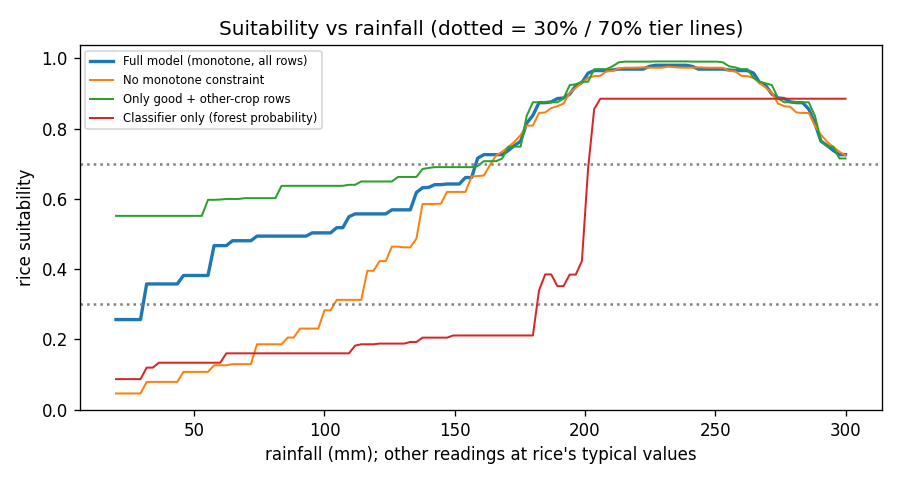

The full model (thick blue line) rises without ever dipping; the unconstrained model (orange) can wobble; the classifier-only score (red) stays flat then jumps. At 20 mm the full model gives 26% (unsuitable). The formula itself gives about 5%, so a single ruined reading is still scored somewhat too generously; this is a known limit of the monotone model.

### 7.3 Cross-dataset validation

**Dataset used:** [`Jakehills/Crop_Yield_Fertilizer`](https://huggingface.co/datasets/Jakehills/Crop_Yield_Fertilizer) (Hugging Face): 25,000 rows, same 7 features, same 22 crops. We checked it: all 2,200 of our original rows appear in it exactly; the other **22,800** rows are augmented rows with a wider spread (e.g. rice temperature 14–31 °C instead of 20–27 °C). Those 22,800 are the *external* set. The file is downloaded to `data/external/` on demand and is not committed (its licence is not stated).

**Honest limit.** The external rows derive from the same Kaggle source, so this tests *robustness to a wider, shifted distribution*, **not independence from the source**. No fully independent public dataset with these exact columns and crops was found; FAO EcoCrop covers only temperature, rainfall and pH.

**Direction 1 – train on ours, test on external:**

| Model | Our test rows | External (22,800 rows) | Drop |
|---|---|---|---|
| Decision tree | 97.7% | 71.6% | −26.1 |
| Random forest | 99.1% | 84.1% | −15.0 |
| Neural network | 99.1% | 88.5% | −10.6 |
| **Suitability (top crop)** | 97.3% | **91.4%** | −5.9 |

**Direction 2 – train on a 2,200-row sample of the external set, test on our original rows:** tree 96.0%, forest 97.9%, network 97.7%. Training on the wider data transfers back well, but training on the narrow data does not transfer forward, which shows the original data covers only a narrow slice of conditions.

Distribution shift (Kolmogorov–Smirnov statistic, 0 = same, 1 = completely different): K 0.091, humidity 0.071, rainfall 0.054, temperature 0.049, pH 0.044, N 0.034, P 0.027.

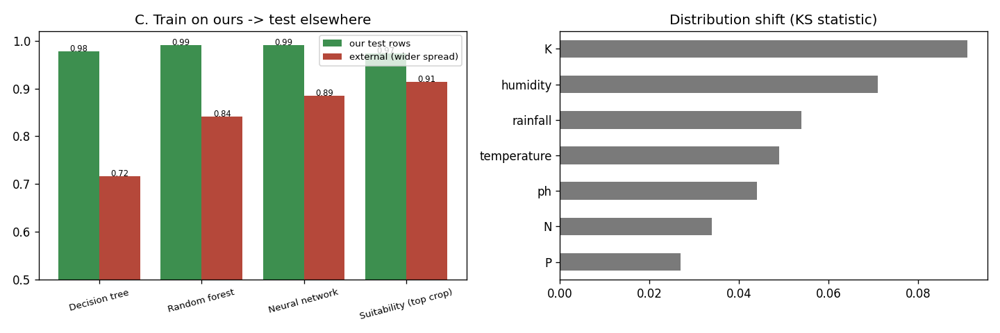

*Findings:* the high in-dataset accuracy **overstates real-world performance**: a decision tree loses 26 points on wider conditions. The suitability model degrades least (−5.9), because it scores *distance from a crop's typical profile* rather than memorising decision boundaries, which supports building it. This is why the website tells users the result is advice, not a command.

---

## 8. Mapping to the PAI101 syllabus

| Syllabus topic | Where |
|---|---|
| Intelligent agents, PEAS, agent types | website "Advisor as an agent" section; simple-reflex (rules), learning (models), utility-based (highest suitability) |
| Knowledge representation, expert systems | §6.5; 16 IF-THEN rules, forward + backward chaining |
| Data and its analysis (descriptive, exploratory, inferential, predictive) | §6.1 and §7.1 |
| Supervised learning | tree, forest, linear/Ridge regression (§6.3) |
| Unsupervised learning | K-means zones (§6.3) |
| Neural networks | MLP vs tree, loss curve (§6.3) |
| Explainable AI | tree plot, importance, SHAP, per-reading score cost (§6.3, §6.6) |
| Edge AI | 182 KB model running in the browser; size/speed table (§6.3) |
| AI security | input validation, label-poisoning demo (§6.3, §9) |
| Ethics and AI for social good | website responsible-use section, §9 |
| Reinforcement learning (discussion) | website future-work note: learn an irrigation policy from rewards |

---

## 9. Limitations, ethics, security

- **Synthetic labels.** Suitability scores follow our own formula over generated rows; they are not measured yields. The footer of the site and this README say so.
- **Narrow, clean data.** The crop data is a teaching dataset (cross-dataset accuracy drops 6–26 points on wider conditions). It does not see soil type, pests, season or prices.
- **Single-reading disasters** are scored a little too generously (§7.2).
- **Yield model** is weak (R² 0.64, country-level averages, linked only to rice and maize) and is labelled "rough idea only".
- **Security.** Impossible sensor values are rejected; out-of-range values warn; label poisoning measurably hurts accuracy (§6.3), so training data must be trusted; no farmer data is sent anywhere (everything runs on the device).
- **Ethics.** Human in the loop: the score is advice, not a command; the data may not represent a user's region; farmers without smartphones or local-language support may be left out (future work); wrong advice costs real income; farmers should own their data.
- **Social good.** Better crop fit means less water and fertiliser wasted, and expert-style advice for farmers who cannot afford an agronomist.

---

## 10. Deployment

`frontend/` is a static site: no build step. Deploy that folder (Vercel project root directory = `frontend`, framework preset "Other"), or locally `cd frontend && python -m http.server 8000`.

---

*Sources: Crop Recommendation Dataset (Kaggle, atharvaingle); FAO-derived Crop Yield Prediction Dataset (Kaggle); `Jakehills/Crop_Yield_Fertilizer` (Hugging Face) for cross-dataset validation; course textbooks Russell & Norvig, Alpaydin.*
